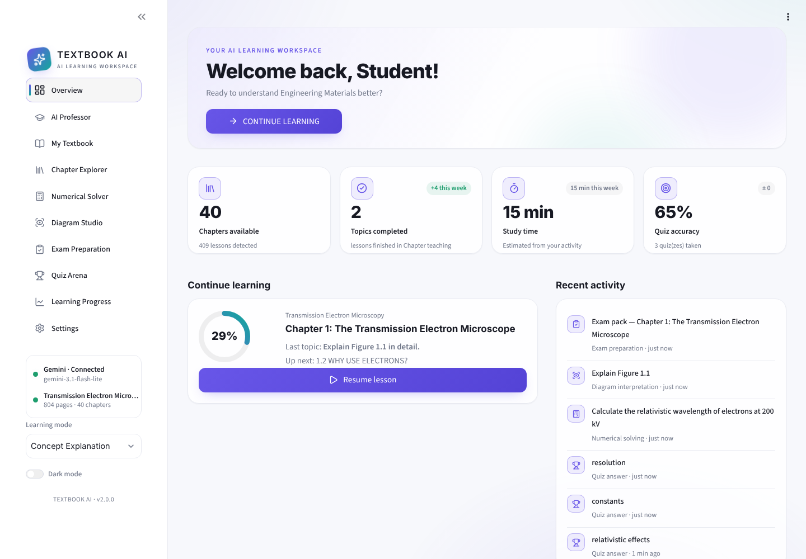
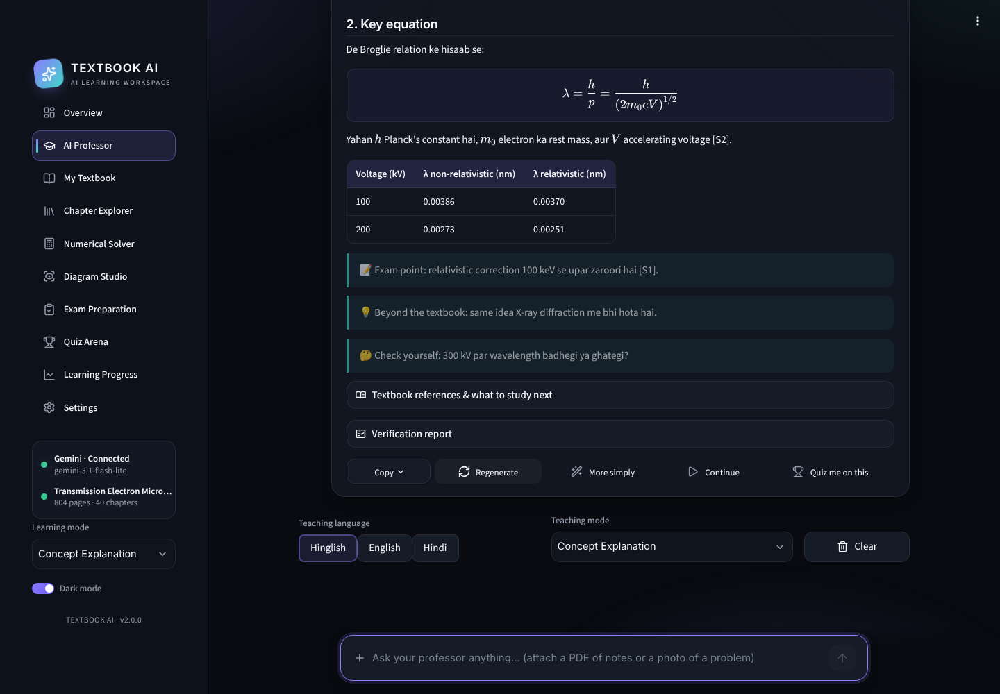

# 🎓 Textbook AI Professor

**An AI teaching assistant that teaches *Transmission Electron Microscopy* (Williams & Carter) like a personal professor, not a generic PDF chatbot.**

It reads the textbook PDF, works out its chapters and sections, and teaches from the book itself. Every answer cites the PDF page it came from, and explanations are available in **Hinglish, English or Hindi**.



---

## ✨ Features

| | |
|---|---|
| 📖 **Chapter-by-chapter teaching** | Lessons follow the textbook's own order, starting with a chapter roadmap and ending each lesson with a recap and a self-check question. |
| 💬 **AI Professor chat** | Answers are grounded in the retrieved textbook passages, with inline citations and PDF page references. Each answer has Copy, Regenerate, More simply, Continue and Quiz me on this actions. |
| ∑ **Mathematical derivations** | Equations are explained symbol by symbol, with assumptions, a dimensional check, a worked example and common exam mistakes. |
| 🖼️ **Diagram Studio** | Explains any textbook figure or PDF page by sending the rendered page image to Gemini. You can also upload your own diagram. |
| 🧮 **Numerical Solver** | Solutions are laid out as given data, formula, substitution, step-by-step calculation, final answer and verification. Accepts a photo of the problem. |
| 📝 **Exam Preparation** | Generates 2-, 5- and 10-mark questions with model answers, plus one-page revision sheets. Downloadable as Markdown. |
| 🏆 **Quiz Arena** | Asks one question at a time (MCQ, true/false, fill in the blank, conceptual, numerical) and reveals the answer only after you respond. Tracks your weak topics. |
| 📈 **Learning Progress** | Shows chapter completion, quiz scores, study activity and topics to revise, all from your real data. |
| 📎 **Your own notes** | Upload lecture notes or handouts. They are searched alongside the textbook and always labelled as your notes. |
| 🌗 **Premium UI** | Dark and light themes, glassmorphism cards, subtle animations, and a mobile-friendly layout. |



---

## 🧠 How it works

```
PDF ──► pdf_processor ──► chapters, sections, figures, tables, semantic chunks
                                   │
                                   ▼
                  retrieval: local embeddings (bge-small) + ChromaDB
                                   │
 question ──► LangGraph agent ─────┤
              1. Query classifier      (rule-based, no API call)
              2. Context retriever     (hybrid vector + keyword, chapter-aware)
              3. Teaching planner      (equations, figures, depth)
              4. Teaching agent        (Gemini, + PDF page images when useful)
              5. Answer verifier       (citation check + optional Gemini review)
              6. Response formatter    (real sources, study recommendations)
              7. Learning-state manager (progress, quiz history, weak topics)
```

**Design choices worth knowing:**

- **Symbol-font repair.** The book's PDF stores Greek letters and math operators in private-encoding fonts, so plain text extraction turns `λ = h/p` into `l ¼ h p`. Each glyph was mapped by rendering it, so equations extract correctly. For complex multi-line equations, the page image is also sent to Gemini.
- **No fabricated citations.** The model can only cite the numbered passages it was given. The source list is generated by the app, not by the model, and invalid tags are stripped out.
- **Free-tier friendly.** Embeddings run locally. Most answers take one Gemini call, or two when the optional verifier is switched on. The textbook is processed once and the result is reused.

---

## 🚀 Getting started

### 1. Requirements
- Python **3.11+**
- A free Gemini API key from [Google AI Studio](https://aistudio.google.com/apikey)
- Your own copy of the textbook PDF (it is **not** included in this repo)

### 2. Install

```bash
git clone https://github.com/<your-username>/textbook-ai-professor.git
cd textbook-ai-professor

python -m venv venv
# Windows
venv\Scripts\activate
# macOS / Linux
source venv/bin/activate

pip install -r requirements.txt
```

### 3. Configure

```bash
# Windows
copy .env.example .env
# macOS / Linux
cp .env.example .env
```

Open `.env` and paste your key:

```env
GEMINI_API_KEY=your_free_api_key
GEMINI_MODEL=gemini-3.1-flash-lite
```

### 4. Run

```bash
streamlit run app.py
```

Then open **My Textbook** and upload the PDF. The first run downloads the embedding model (~130 MB) and indexes the book locally, which takes a few minutes on a laptop CPU. After that, the index is reused instantly.

---

## ⚙️ Configuration

All settings live in `.env`; see `.env.example`.

| Variable | Default | Purpose |
|---|---|---|
| `GEMINI_API_KEY` | — | Your Gemini API key (required) |
| `GEMINI_MODEL` | `gemini-3.1-flash-lite` | Any Gemini model your key can use |
| `VERIFY_ANSWERS` | `true` | Run the second "answer verifier" call |
| `EMBEDDING_MODEL` | `BAAI/bge-small-en-v1.5` | Local sentence-transformers model |
| `TOP_K` | `6` | Passages retrieved per question |
| `MAX_CONTEXT_CHARS` | `14000` | Context size sent to Gemini |
| `MIN_RELEVANCE` | `0.5` | Below this similarity, the app says the book doesn't cover the question |

---

## 📁 Project structure

```
textbook-ai-professor/
├── app.py             # Streamlit UI: pages, design system, theme switcher
├── agent.py           # LangGraph agent, Gemini client, quizzes, progress
├── retrieval.py       # Local embeddings, ChromaDB, hybrid retrieval
├── pdf_processor.py   # Extraction, symbol-font repair, chapters, chunking
├── prompts.py         # System prompt and teaching-mode instructions
├── config.py          # Settings loaded from .env
├── requirements.txt
├── .env.example
└── data/              # Created at runtime: processed books, vector index, progress
```

---

## 🛠️ Tech stack

**LangGraph** · **Google Gemini** (`google-genai`) · **ChromaDB** · **sentence-transformers** · **PyMuPDF** · **Streamlit** · **Plotly** · **Pydantic**

---

## ⚠️ Notes & limitations

- **Bring your own PDF.** The textbook is copyrighted, so it is not distributed here. Processed data in `data/` stays on your machine and is git-ignored.
- **Tuned for this book.** The symbol-font repair is built for this textbook's fonts. Other PDFs still work (chapters are detected from bookmarks or headings), but their equations may extract less cleanly.
- **Free-tier limits.** Google sets the free-tier rate limits per key. If you hit them, wait a minute or turn off *Double-check answers* in Settings.
- **AI can be wrong.** Answers are grounded and cited, but check important results against the cited pages, especially before exams.

---

## 👤 Author

**Rishi Maddheshiya** · B.Tech Metallurgical & Materials Engineering, IIT Roorkee

If you find this useful, consider giving the repo a ⭐.
