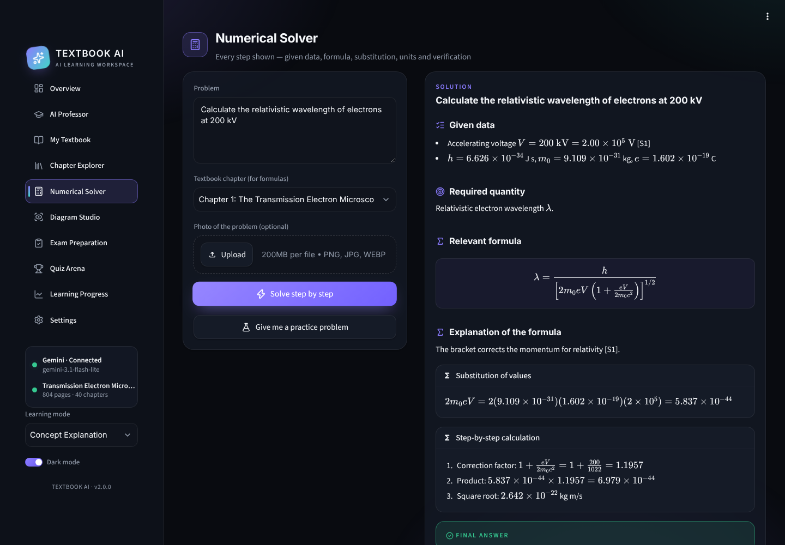
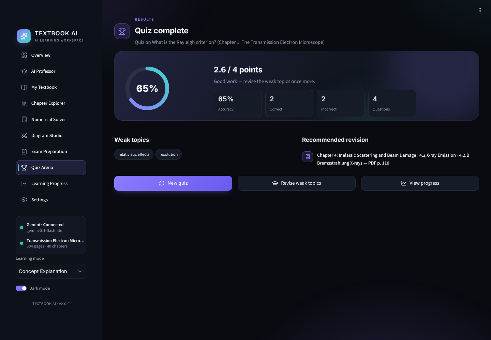
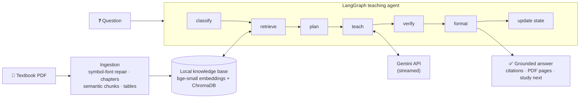

# 🎓 Textbook AI Professor

**An AI teaching assistant that teaches *Transmission Electron Microscopy* (Williams & Carter) like a personal professor, not a generic PDF chatbot.**

Upload the textbook once. The app works out its chapters, sections, equations, figures and tables, builds a private knowledge base on your machine, and then teaches from the book itself. It runs chapter-by-chapter lessons, derivations, diagram walkthroughs, worked numericals, exam packs and quizzes. Every answer cites the PDF pages it came from.


<p align="center">
  <a href="#-features">Features</a> ·
  <a href="#-how-it-works">How it works</a> ·
  <a href="#-quick-start">Quick start</a> ·
  <a href="#-deployment">Deployment</a> ·
  <a href="docs/ARCHITECTURE.md"><b>Architecture</b></a>
</p>

---

## ✨ Features

| | |
|---|---|
| 📖 **Chapter teaching** | Lessons follow the textbook's own section order, starting with a chapter roadmap and ending each lesson with a recap and a self-check question. Your place in every chapter is saved. |
| 💬 **AI Professor chat** | Answers are grounded in retrieved passages, with inline `[S#]` citations and PDF page references, and stream onto the screen as they are written. Each answer has Copy, Regenerate, Explain more simply, Continue and Quiz me on this. |
| ∑ **Derivations** | Equations are explained symbol by symbol, with assumptions, a dimensional check, a worked example and common exam mistakes. The page image is read so equations stay exact. |
| 🖼️ **Diagram Studio** | Explains any textbook figure or PDF page from the rendered page image, or a diagram you upload: labels, mechanism, and how to draw it in the exam. |
| 🧮 **Numerical Solver** | Solutions laid out as given data, formula, substitution, step-by-step calculation, final answer and verification. Accepts a photo of the problem. |
| 📝 **Exam Preparation** | 2-, 5- and 10-mark questions with model answers, plus one-page revision sheets. Downloadable as Markdown. |
| 🏆 **Quiz Arena** | MCQ, true/false, fill in the blank, conceptual and numerical questions, one at a time, with the answer revealed only after you respond. Tracks your weak topics. |
| 📈 **Learning Progress** | Chapter completion, quiz performance, study activity and topics to revise, all from your real activity. |
| 📎 **Your notes** | Upload lecture notes. They are searched alongside the textbook and always labelled as your notes. |
| 🌗 **Premium UI** | Dark and light themes, glassmorphism, subtle animations, Lucide icons, and a mobile-friendly layout. |

<table>
  <tr>
    <td></td>
    <td></td>
  </tr>
  <tr>
    <td align="center"><sub>Numerical Solver</sub></td>
    <td align="center"><sub>Quiz Arena results</sub></td>
  </tr>
</table>

---

## 🧠 How it works



1. **Ingestion.** PyMuPDF extracts every page and repairs the book's private symbol fonts, so `l ¼ h p` becomes
   `λ = h/p`. It detects chapters from the PDF bookmarks and splits the text into section-aware chunks that keep
   equations together with their explanations.
2. **Knowledge base.** Chunks are embedded locally with `BAAI/bge-small-en-v1.5` and stored in ChromaDB, with chapter,
   section and page metadata. This happens once per book.
3. **Teaching agent.** A LangGraph pipeline classifies the request (rule-based, no API call), retrieves passages with
   hybrid search, plans the explanation, and has Gemini teach it in the chosen mode. It then checks the citations,
   adds the real source list, and updates your progress.
4. **Grounding.** The model can cite only the passages it was given. Fake citations are removed, page numbers that
   weren't retrieved are flagged, and anything from outside the book is labelled *Beyond the textbook*.

For the full design, with ten diagrams covering the module reference, ingestion internals, the retrieval scoring
formula, agent nodes, the life of a question, the state machines, the data model and deployment, see
**[docs/ARCHITECTURE.md](docs/ARCHITECTURE.md)**.

---

## 🚀 Quick start

**Requirements:** Python 3.11+, a free Gemini API key from [Google AI Studio](https://aistudio.google.com/apikey),
and your own copy of the textbook PDF (it is **not** included in this repo).

```bash
git clone https://github.com/<your-username>/textbook-ai-professor.git
cd textbook-ai-professor

python -m venv venv
venv\Scripts\activate            # Windows
# source venv/bin/activate       # macOS / Linux

pip install -r requirements.txt
copy .env.example .env           # Windows  (macOS / Linux: cp .env.example .env)
```

Put your key in `.env`:

```env
GEMINI_API_KEY=your_free_api_key
GEMINI_MODEL=gemini-3.1-flash-lite
```

Run the app:

```bash
streamlit run app.py
```

Open **My Textbook** and upload the PDF. The first run downloads the embedding model (~130 MB) and indexes the book,
which takes a few minutes on a laptop CPU. After that, everything is reused instantly.

---

## ⚙️ Configuration

Settings are read from `.env` (locally) or from Streamlit secrets (on Streamlit Cloud). The most useful ones:

| Variable | Default | Purpose |
|---|---|---|
| `GEMINI_API_KEY` | — | Your Gemini key (required) |
| `GEMINI_MODEL` | `gemini-3.1-flash-lite` | Use `gemini-3.8-flash` for stronger answers |
| `GEMINI_THINKING_LEVEL` | `low` | `minimal` / `low` / `medium` / `high` — lower is faster |
| `VERIFY_ANSWERS` | `false` | Second "verifier" call (more checking, ~2× slower) |
| `TOP_K` | `6` | Passages retrieved per question |
| `MIN_RELEVANCE` | `0.5` | Below this similarity, the app says the book doesn't cover the question |

The full list is in [`.env.example`](.env.example) and in the
[configuration reference](docs/ARCHITECTURE.md#15-configuration-reference).

---

## ☁️ Deployment

The app runs on **[Streamlit Community Cloud](https://share.streamlit.io)** for free:

1. Push this repo to GitHub. Never push `.env` or the PDF; both are git-ignored.
2. On Streamlit Community Cloud, choose **Create app**, pick this repository, and set the main file to `app.py`.
3. Under **Advanced settings**, choose Python 3.12 and add your secrets:
   ```toml
   GEMINI_API_KEY = "your_key"
   GEMINI_MODEL = "gemini-3.1-flash-lite"
   ```
4. Deploy, open the app, and upload the textbook in **My Textbook**.

> **Keep the deployed app private** (*Share → Only specific people can view this app*). A public app would let anyone
> use your Gemini quota, and the textbook is copyrighted.

---

## 📁 Project structure

```
textbook-ai-professor/
├── app.py             # Streamlit UI: 10 pages, design system, themes, UI adapters
├── agent.py           # LangGraph agent, Gemini client (streaming, retries), quizzes, progress
├── retrieval.py       # Local embeddings, ChromaDB, hybrid retrieval, cited context
├── pdf_processor.py   # Extraction, symbol-font repair, chapter detection, chunking, tables
├── prompts.py         # Professor system prompt, teaching-mode templates, verifier and quiz prompts
├── config.py          # Settings from .env or Streamlit secrets
├── requirements.txt
├── .env.example
├── docs/
│   ├── ARCHITECTURE.md
│   └── *.png          # screenshots
└── data/              # created at runtime: processed books, vector index, progress (git-ignored)
```

---

## 🛠️ Tech stack

| Layer | Technology |
|---|---|
| Agent orchestration | LangGraph |
| LLM | Google Gemini (`google-genai`): streaming, structured output |
| Embeddings | sentence-transformers, `BAAI/bge-small-en-v1.5` (local, CPU) |
| Vector store | ChromaDB (persistent, local) |
| PDF processing | PyMuPDF |
| UI | Streamlit, custom CSS design system, Plotly, Lucide icons |
| Data models | Pydantic |

---

## ⚠️ Limitations

- **Bring your own PDF.** The textbook is copyrighted and not distributed here.
- **Tuned for this book.** The symbol-font repair is built for this textbook's fonts. Other PDFs work (chapters are
  detected from bookmarks or headings), but their equations may extract less cleanly.
- **Free-tier limits.** Google sets rate limits per key. If you see "rate limit" or "overloaded", wait a minute or try
  another `GEMINI_MODEL`.
- **AI can be wrong.** Answers are grounded and cited, but check important results against the cited pages,
  especially before exams.

---

## 👤 Author

**Rishi Maddheshiya** · B.Tech Metallurgical & Materials Engineering, IIT Roorkee

If this project helps you, consider giving it a ⭐.
