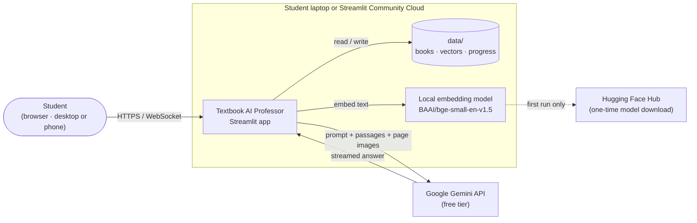
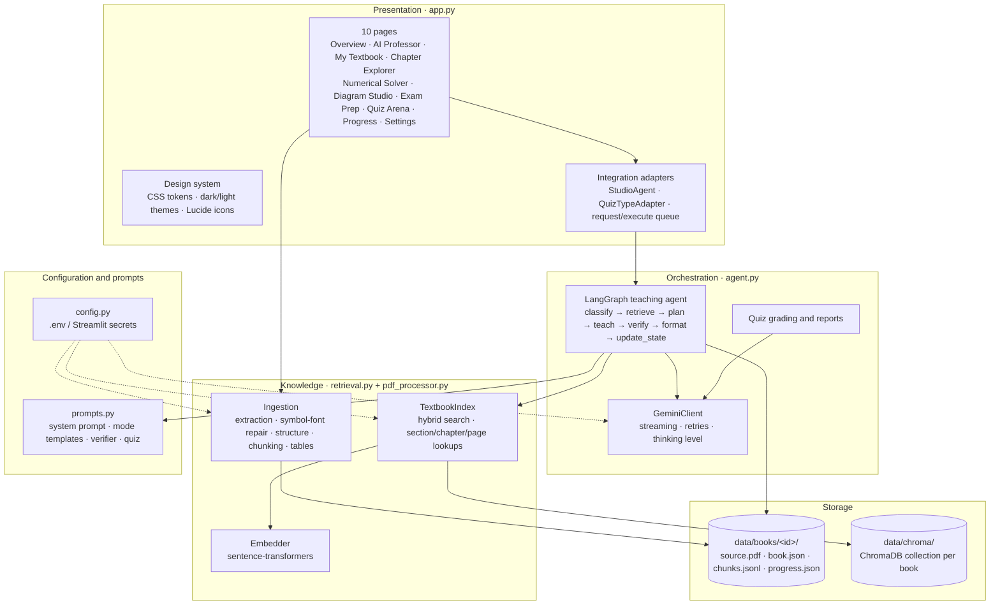
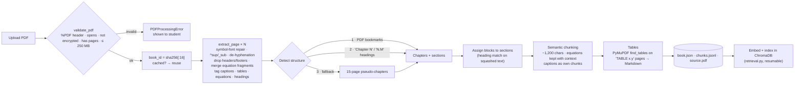
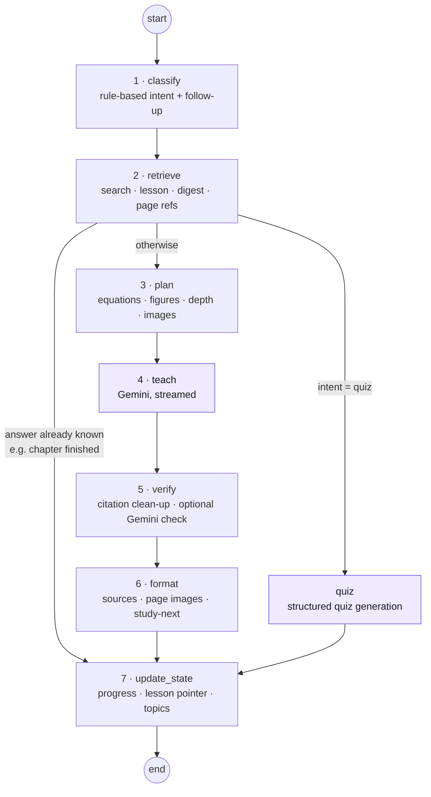
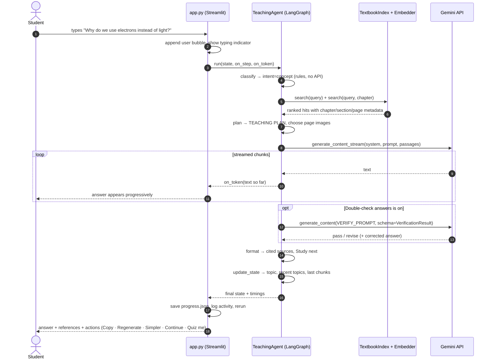
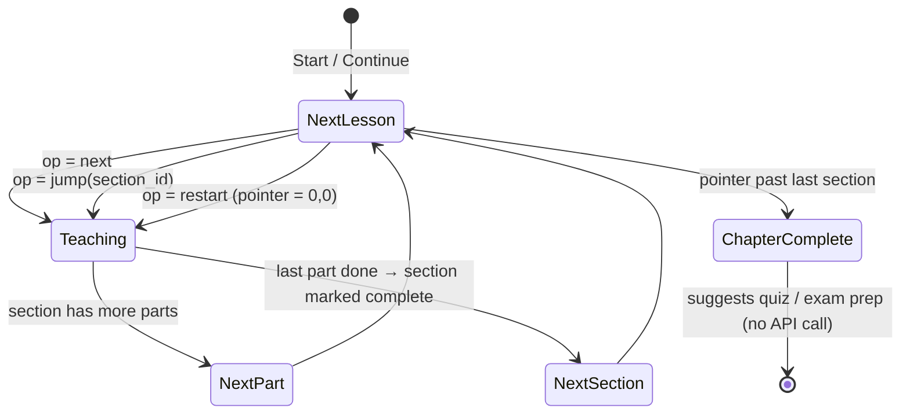
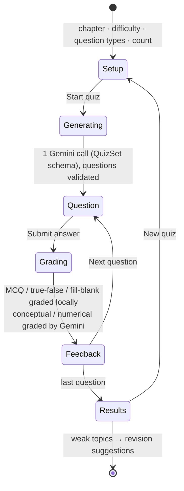
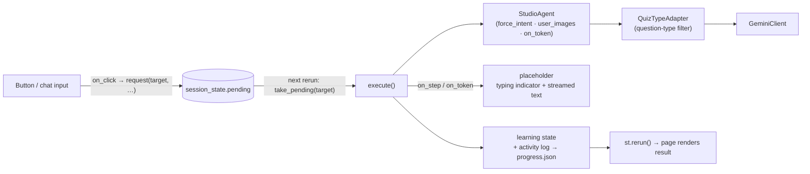
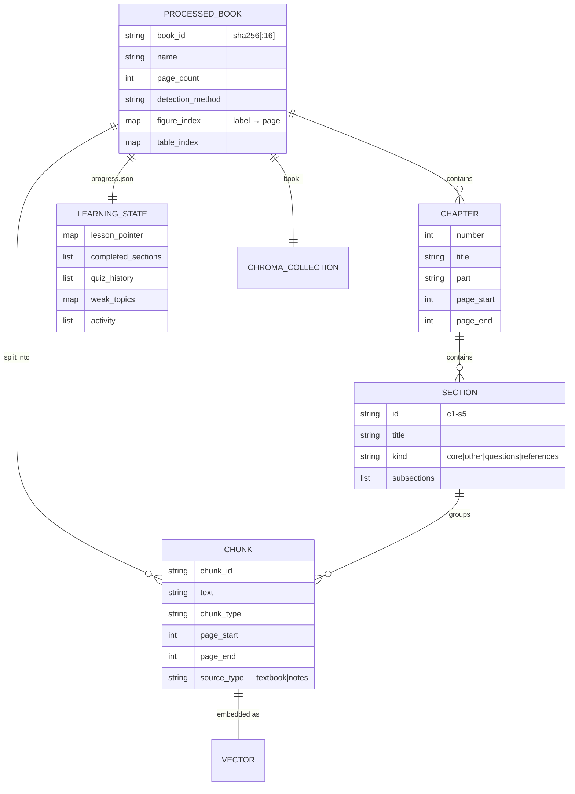
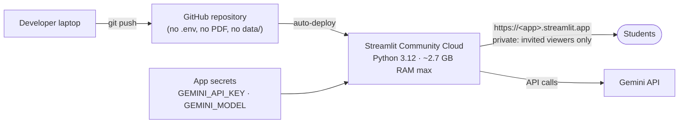

# Textbook AI Professor — Architecture

This document explains how the application is built: the components, how a textbook becomes a searchable
knowledge base, how a question becomes a grounded answer, where state lives, and the design decisions behind
each part. It describes the code as it is in this repository.

**Contents**

1. [Goals and design principles](#1-goals-and-design-principles)
2. [System context](#2-system-context)
3. [Layered architecture](#3-layered-architecture)
4. [Module reference](#4-module-reference)
5. [Ingestion pipeline](#5-ingestion-pipeline-pdf_processorpy)
6. [Knowledge base and retrieval](#6-knowledge-base-and-retrieval-retrievalpy)
7. [The teaching agent](#7-the-teaching-agent-agentpy)
8. [Life of a question](#8-life-of-a-question-end-to-end)
9. [Chapter teaching and quizzes](#9-chapter-teaching-and-quizzes)
10. [Grounding and hallucination safeguards](#10-grounding-and-hallucination-safeguards)
11. [Gemini client](#11-gemini-client)
12. [Presentation layer](#12-presentation-layer-apppy)
13. [Data model and persistence](#13-data-model-and-persistence)
14. [Performance and API budget](#14-performance-and-api-budget)
15. [Configuration reference](#15-configuration-reference)
16. [Deployment](#16-deployment)
17. [Security and privacy](#17-security-and-privacy)
18. [Known limitations and future work](#18-known-limitations-and-future-work)

---

## 1. Goals and design principles

The application teaches one textbook, *Transmission Electron Microscopy* (Williams & Carter), the way a professor
would: chapter by chapter, with derivations, figures, worked numericals, exam material and quizzes. It is not a
general PDF chatbot.

| Principle | What it means in the code |
|---|---|
| **The textbook is the source of truth** | Every answer is generated from retrieved passages. The model can cite only the numbered passages it was given, and the app, not the model, builds the source list. |
| **Never fake a citation** | Invalid `[S#]` tags are stripped, model-written "Sources" sections are removed, and page numbers that weren't retrieved are flagged. |
| **Free and local where possible** | PDF processing, embeddings and the vector store all run on the student's laptop. Only text generation calls Gemini, using the free tier. |
| **Few API calls** | Classification, planning, formatting and state updates are deterministic Python. A normal answer costs one Gemini call. |
| **Process once** | A PDF is identified by its SHA-256 hash. Its structure, chunks and vectors are saved and reused across sessions. |
| **Honest UI** | No fabricated statistics or fake progress bars. Progress shows real backend events, and study time is labelled as an estimate. |

---

## 2. System context



Only two things leave the machine: the Gemini request (prompt, retrieved passages and, when needed, a rendered
PDF page image) and the one-time download of the embedding model. The PDF, the vector index and the
learning progress stay in `data/`.

---

## 3. Layered architecture



Dependencies point downward only. `app.py` depends on `agent.py`, `retrieval.py` and `pdf_processor.py`. The
backend modules never import Streamlit; the one exception is `config.py`, which reads Streamlit secrets when they exist.

---

## 4. Module reference

| File | ~Lines | Responsibility | Key public API |
|---|---:|---|---|
| `config.py` | 105 | Settings from `.env`, environment or Streamlit secrets. API-key validation. | `settings`, `Settings.with_api_key()`, `api_key_problem()` |
| `pdf_processor.py` | 860 | PDF validation, page extraction with symbol-font repair, chapter/section detection, semantic chunking, table extraction, persistence, page rendering. | `process_pdf()`, `process_notes_pdf()`, `load_book()`, `load_chunks()`, `list_books()`, `render_page_png()` |
| `retrieval.py` | 275 | Local embeddings, ChromaDB storage, hybrid retrieval, context building with numbered sources. | `Embedder`, `TextbookIndex`, `build_context()`, `relevant()` |
| `prompts.py` | 200 | Core system prompt, grounding rules, explanation levels, eight teaching-mode templates, follow-up templates, verifier and quiz prompts. | `system_prompt()`, `MODE_INSTRUCTIONS`, `VERIFY_PROMPT`, `QUIZ_PROMPT` |
| `agent.py` | 1,030 | Gemini client, structured output models, LangGraph agent, intent classifier, lesson/digest builders, learning state, quiz grading. | `GeminiClient`, `TeachingAgent`, `classify_query()`, `grade_answer()`, `record_quiz_answer()` |
| `app.py` | 2,230 | Streamlit UI: design system, navigation, ten pages, session state, UI adapters around the agent. | `main()` |

---

## 5. Ingestion pipeline (`pdf_processor.py`)



On the TEM textbook (804 pages), text processing takes about 20 seconds. It finds 40 chapters, around 600 figure
captions, 35 structured tables and roughly 3,180 chunks.

### 5.1 Symbol-font repair

Publisher PDFs often draw Greek letters and math operators with private-encoding fonts, so plain extraction
turns `λ = h/p` into `l ¼ h p`. `_FONT_MAPS` translates each span's characters according to its font. The mappings
were built by rendering every glyph of the book's fonts and reading it:

| Font family | Contains | Example mappings |
|---|---|---|
| `AdvPi1` | Greek (custom layout) | `l→λ`, `y→θ`, `c→ψ`, `q→∂`, `8→°` |
| `AdvSymb*` | Greek (standard Adobe Symbol layout) | `a→α`, `b→β`, `c→χ` |
| `AdvP4C4E74` | Operators | `¼→=`, `ð/Þ→( )`, `þ→+`, `\x03→×`, `\x05→±` |
| `AdvP4C4E51/59/46` | Decimal points, overbars, large delimiters | `:→.`, `\x02→◌̅`, radicals, ∑, ∫ |
| Any `*Symbol*` font | Legacy Symbol fonts in other books | Standard Symbol table |

Smaller font spans that sit above or below the line's baseline become `^{…}` or `_{…}`, and adjacent scripts are merged.
Simple equations therefore come out exactly, for example `θ_0 = 0.117Z^{1/3} / E_0^{1/2} (3.4)`. Complex multi-line
equations remain imperfect as text, so the agent also sends the rendered page image in those cases (§7.3).

### 5.2 Structure detection

1. **Bookmarks (preferred).** A top-level entry counts as a chapter if its children are numbered `N.M` or its title is
   `Chapter N`. "Part" entries become part labels. Each child section gets a *kind*:
   - `core`: numbered sections
   - `other`: unnumbered sections before the numbered ones
   - `questions`: self-assessment questions
   - `references`: anything after the numbered body, such as URLs, journals and reading lists

   Only `core` and `other` sections are taught as lessons.
2. **Headings.** Bold or large `Chapter N` and `N.M Title` headings.
3. **Page ranges.** The last-resort fallback: 15-page pseudo-chapters.

### 5.3 Chunking rules

- Blocks are grouped by their level-2 section, so a chunk never straddles two sections.
- The target size is 1,200 characters, with a hard maximum of 1,900. Longer blocks are split on sentence boundaries.
- An equation block stays together with the paragraph before it and the "where …" paragraph after it.
- One short trailing paragraph (under 350 characters) overlaps into the next chunk, so explanations aren't cut mid-thought.
- Figure captions become their own `figure_caption` chunks, carrying the figure label in their metadata.

**Chunk metadata** (stored in ChromaDB and `chunks.jsonl`):

| Field | Example |
|---|---|
| `chunk_id` | `e1412d29847686dc-000051` (tables: `…-t03145`) |
| `chapter_no`, `chapter_title` | `1`, `Chapter 1: The Transmission Electron Microscope` |
| `section_id`, `section_title` | `c1-s5`, `1.5 SOME FUNDAMENTAL PROPERTIES OF ELECTRONS` |
| `page_start`, `page_end` | `69`, `69` (1-based PDF pages) |
| `chunk_type` | `text` · `figure_caption` · `table` · `questions` · `references` |
| `figure_labels` | `1.9` |
| `source_type`, `source_name` | `textbook` or `notes` |
| `order` | Reading order within the book |

---

## 6. Knowledge base and retrieval (`retrieval.py`)

- **Embeddings.** `BAAI/bge-small-en-v1.5` runs locally on the CPU (33M parameters, 512-token window). Vectors are
  normalized. Each document is embedded together with its chapter and section title as a header. Queries get the
  BGE retrieval instruction prefix and are cached in memory.
- **Store.** A persistent ChromaDB client lives in `data/chroma/`, with one collection per book (`book_<id>`) using
  cosine distance. Indexing is idempotent and resumable: only chunk IDs that are missing get embedded.

### 6.1 Hybrid scoring

```
score = cosine_similarity
      + 0.12 × (fraction of query keywords present in the chunk)
      + 0.35 if the query names a figure ("Figure 2.3") and the chunk is that figure's caption
      + 0.30 if the query names an equation ("equation 3.4") and the chunk contains "(3.4)"
```

The vector search asks Chroma for `k × 4` candidates, excluding `references` chunks by default, and re-ranks them
with the score above. Explicit figure and equation references are also looked up directly by metadata or text, and
those *pinned* hits go first. Near-duplicate neighbours created by the chunk overlap are removed.

### 6.2 How the agent uses retrieval

| Situation | Strategy |
|---|---|
| Normal question | Whole-book search plus a search inside the selected chapter (chapter hits get +0.04). Results are merged, and hits more than 0.15 below the best are dropped, keeping at least 3. |
| Follow-up ("make it simpler") | The chunks from the previous answer, plus a new search on *topic + follow-up*. |
| "page 160" in the question | That page's chunks, plus its rendered page image. |
| Chapter lesson | All chunks of the current section in reading order, sliced into ~7,000-character lessons. |
| Exam pack / revision / quiz with no topic | A chapter digest: an even character budget per section, preferring chunks that contain numbered equations. Exam packs and quizzes also include the book's end-of-chapter questions. |
| No hit above `MIN_RELEVANCE` (0.5) | `low_context` is set, and the answer must say the book doesn't cover the question. |

`build_context()` numbers the passages `[S1]`, `[S2]`, … with their kind and source label, capped at 14,000
characters. It returns the prompt text and the source list that the UI displays.

---

## 7. The teaching agent (`agent.py`)

### 7.1 Graph



Purple nodes call Gemini. `verify` calls Gemini only when *Double-check answers* is switched on. Every other node is
deterministic Python.

### 7.2 Node reference

| Node | Input → output | Gemini calls |
|---|---|---:|
| `classify` | query, mode, history → `intent`, `followup`, `retrieval_query` | 0 |
| `retrieve` | intent, chapter → `hits`, `context`, `sources`, `image_pages`, `lesson`, `low_context` | 0 |
| `plan` | context → `plan` (equations, figures, sections) + a `TEACHING PLAN` text block | 0 |
| `teach` | system prompt + mode template + plan + history + passages (+ page images) → `draft` | 1 |
| `verify` | draft → cleaned `answer`, `verification` report, `warnings` | 0 (1 if enabled) |
| `format` | answer → answer + footer (cited sources, page images, *Study next*), `suggestions` | 0 |
| `quiz` | chapter digest → `quiz` (validated questions) | 1 |
| `update_state` | everything → `learning` (persisted by the UI) | 0 |

`TeachingAgent.run()` streams graph updates, reports each finished node to the UI (which drives the loading steps),
and records per-node timings, shown under each answer as `⏱ 6.8 s · Gemini 5.9 s · textbook search 0.4 s`.

### 7.3 Intent classification

`classify_query()` is rule-based, so it needs no API call. The order of precedence is:

1. **Button actions** (`teach`, `quiz`, `exam`, `revision`) map directly to an intent.
2. **Follow-ups** (short message plus history): `simpler`, `detail`, `example`, `exam`, `continue`, `again`,
   `reference` ("the second equation"), `why`.
3. **Explicit cues** in the text: quiz → exam_prep → revision → comparison → derivation → diagram → chapter_teaching.
4. **Numerical detection**: words like "calculate" or "find" together with numbers or units (kV, nm, mrad, …).
5. **The selected learning mode.** In chapter-teaching mode, typed questions become `concept` so they get answered
   in place.

| Intent | Template (`prompts.py`) | Page images |
|---|---|---|
| `chapter_teaching` | Lesson in textbook order, roadmap on the first lesson, recap + check question | Up to 2 (pages with captions or equations) |
| `concept` | 10-heading concept explanation | Only when a page is named |
| `derivation` | 10-step derivation, units, exam mistakes | Page of the referenced equation |
| `diagram` | Labels, axes, mechanism, how to draw it | Figure page (or the named page) |
| `numerical` | Given → required → formula → substitution → steps → answer → verification | — |
| `comparison` | Comparison table + key difference | — |
| `exam_prep` | 2/5/10-mark questions with model answers | — |
| `revision` | One-page revision sheet | — |
| `general` | Direct answer | — |

### 7.4 Prompt assembly

```
system  = core professor prompt (18 rules + teaching philosophy)
        + grounding rules ([S#] citations, "💡 Beyond the textbook", LaTeX, no invented pages)
        + English-only rule + explanation level (Beginner/Intermediate/Advanced)
        + book outline (40 chapters with PDF page ranges)

user    = mode template (+ roadmap / image instructions)
        + follow-up instruction (if any)
        + TEACHING PLAN (sections, equations, figures, images, level, lesson position)
        + conversation so far (last 6 messages; the last answer in full for follow-ups)
        + TEXTBOOK PASSAGES ([S1] … [Sn])
        + student's message
        + up to 2 rendered PDF page images (PNG, 130 dpi)
```

---

## 8. Life of a question (end to end)



---

## 9. Chapter teaching and quizzes

### 9.1 Lesson pointer

Each chapter's lessons form a sequence: the chapter introduction, followed by every `core`/`other` section. A section
longer than 7,000 characters is split into parts. `learning.lesson_pointer[chapter] = {section_idx, part}` always
points at the **next** lesson to teach.



### 9.2 Quiz lifecycle



Generated questions are normalized before use. For MCQs, a letter answer ("B") is mapped to its option text, and a
near-miss answer is fuzzy-matched to an option; questions that can't be repaired are dropped. True/false questions
get fixed options. The correct answer is never rendered until the student submits. Wrong answers increment
`weak_topics[topic]`, and finished quizzes append to `quiz_history`.

---

## 10. Grounding and hallucination safeguards

| Risk | Safeguard |
|---|---|
| Answering from general knowledge | The system prompt makes the passages the source of truth. Knowledge from outside them must be marked `💡 Beyond the textbook`. |
| Question not covered by the book | `low_context` detection forces an explicit "not covered" statement and a warning banner. |
| Fake citations | The model can only reference `[S#]` tags. Unknown tags are removed. The source list is built from the actual retrieved chunks. |
| Invented page numbers | `PDF p. N` mentions outside the retrieved pages are flagged in the verification report. |
| Garbled equations | Symbol-font repair, plus the rendered page image for derivations, diagrams and lessons. The prompt forbids "fixing" an equation into something the book doesn't say. |
| Wrong maths or units | The optional verifier checks claims, equations, units and missing points against the passages, and returns a structured verdict. |
| Model-written source lists | `clean_answer()` strips them. LaTeX delimiters are normalized so equations render. |
| Student notes passed off as the textbook | Notes chunks are labelled "student's own notes", and the UI marks them in the references. |

---

## 11. Gemini client

`GeminiClient` wraps the `google-genai` SDK.

| Feature | Behaviour |
|---|---|
| Streaming | `generate_stream()` passes text to the UI as it arrives. Retries happen only *before* the first chunk, so a partly shown answer never restarts. |
| Structured output | `generate(schema=…)` with Pydantic models (`VerificationResult`, `QuizSet`, `AnswerEvaluation`). |
| Thinking level | `GEMINI_THINKING_LEVEL` (default `low`) cuts latency. If the model rejects it, the client retries without it and remembers. |
| Retries | Rate limits, 5xx errors and network failures get exponential backoff that honours `retryDelay` (max 2 retries, max 20 s per wait). Each wait is reported to the UI. |
| Daily quota exhausted | Fails immediately with a clear message instead of retrying. |
| Error messages | Mapped to safe, actionable text (bad key, model not found, overloaded, …). The API key never appears in messages. |
| Truncation | `MAX_TOKENS` adds a note asking the student to type **continue**. |

---

## 12. Presentation layer (`app.py`)

### 12.1 Pages

| Page | Backed by |
|---|---|
| Overview | Learning state, activity log, `chapter_stats()` |
| AI Professor | Agent (chat history passed in), streaming, message actions |
| My Textbook | `process_pdf()`, `TextbookIndex.index_chunks()`, notes ingestion |
| Chapter Explorer | Book structure, cached chapter intros and equations; grid/list view, search, filters (`@st.fragment`) |
| Numerical Solver | Agent with `intent=numerical`, optional problem photo; answer split into sections |
| Diagram Studio | Agent with `intent=diagram` (figure or PDF page) or `general` with an uploaded image |
| Exam Preparation | Agent with `exam`/`revision` actions; Markdown download |
| Quiz Arena | Agent quiz node + `grade_answer()` / `record_quiz_answer()` |
| Learning Progress | Plotly charts of real chapter, quiz and activity data |
| Settings | Theme, teaching defaults, verifier toggle, API key, data reset |

### 12.2 UI integration pattern



- **Requests are queued, not run inside callbacks.** Buttons call `request()`, which stores the request and
  switches page. The target page runs it on the next render, which keeps Streamlit's rerun model predictable.
- **Adapters instead of backend changes.** `StudioAgent` subclasses `TeachingAgent` to force an intent for
  dedicated workspaces and to attach uploaded images. `QuizTypeAdapter` wraps the client so a quiz uses only the
  selected question types.
- **Preferences survive page changes.** Widget keys are garbage-collected when a widget isn't rendered, so every
  setting lives in a `p_*` session key. `bound()` syncs widgets to those keys.
- **Version tolerance.** `compat()` drops widget arguments the installed Streamlit doesn't support. A banner asks
  for Streamlit 1.66+, which the design's CSS targets.

### 12.3 Design system

- **Tokens.** One CSS block holds the dark and light palettes (background, cards, accent `#8B7CFF`/`#6856E8`,
  secondary `#42D6C8`/`#12A99A`, semantic colours), typography (Inter, Plus Jakarta Sans), radii and shadows.
  `build_css()` injects the active theme as CSS variables.
- **Icons.** 59 Lucide icons are embedded as inline SVG. Native buttons get icons through CSS masks keyed on
  Streamlit's `st-key-*` classes, so they stay real, functional buttons.
- **Stable selectors.** All widget styling targets `data-testid` attributes or keyed containers, never generated
  class names.
- **Motion.** Page fade/slide transitions, card hover lift, message fade-in, typing dots, animated rings and bars.
  Everything is disabled under `prefers-reduced-motion`. Touch devices get `:active` feedback instead of hover.
- **Responsive.** Columns stack below 640 px. A tiny script closes the overlay sidebar after navigation on screens
  narrower than 768 px.

---

## 13. Data model and persistence



### 13.1 Directory layout

```
data/
├── books/
│   └── <book_id>/
│       ├── source.pdf      # copy of the uploaded PDF (for page rendering)
│       ├── book.json       # ProcessedBook: chapters, sections, figure/table index
│       ├── chunks.jsonl    # every chunk with metadata
│       └── progress.json   # learning state for this book
└── chroma/                 # ChromaDB persistent store, one collection per book
```

### 13.2 Learning state (`progress.json`)

| Key | Meaning |
|---|---|
| `current_chapter`, `current_topic` | Where the student is |
| `lesson_pointer` | `{chapter: {section_idx, part}}`, the next lesson |
| `completed_sections`, `chapters_started` | Lesson completion |
| `recent_topics` (10), `discussed` (60) | Topic history |
| `quiz`, `quiz_history`, `weak_topics`, `asked_questions` | Quiz state, results, misses, de-duplication |
| `last_chunk_ids`, `last_intent`, `last_lesson` | Context for follow-ups and "repeat" |
| `activity` (400) | Timestamped events written by the UI. Drives *Recent activity*, the study-activity chart and the **estimated** study time (gaps ≤ 30 min count as study, plus 3 min per session). |

### 13.3 Caching

| Cache | What |
|---|---|
| `st.cache_resource` | Embedder (one model per process), `TextbookIndex` per book, `GeminiClient` per key, search warm-up |
| `st.cache_data` | Chapter intros, chapter equation lists, rendered page PNGs |
| In memory | Query-embedding cache (256 entries), session chats, preferences |

---

## 14. Performance and API budget

| Action | Gemini calls | Notes |
|---|---:|---|
| Chat question / lesson / derivation / diagram / numerical | 1 (2 with verifier) | Streamed. Up to 2 page images. |
| Follow-up (simpler, continue, …) | 1 (2) | Reuses the previous chunks |
| Exam pack / revision sheet | 1 (2) | Chapter digest context (~20k chars) |
| Generate quiz | 1 | Structured output |
| Grade MCQ / true-false / fill-blank | 0 | Local. A fill-blank answer that matches no accepted answer falls back to 1 call. |
| Grade conceptual / numerical answer | 1 | Partial credit |
| Chapter finished, navigation, progress, explorer | 0 | |

**Latency measures:**
- streaming (first words appear in a second or two)
- `low` thinking level
- verifier off by default
- local embeddings with a warm-up at app start
- capped retries
- a per-answer timing line that shows where the time goes

**One-time costs:**
- text processing: ~20 s for 804 pages
- embedding: a few minutes on a laptop CPU
- model download: ~130 MB

---

## 15. Configuration reference

Values are read from the environment / `.env` first, then from Streamlit secrets.

| Variable | Default | Purpose |
|---|---|---|
| `GEMINI_API_KEY` | — | Required |
| `GEMINI_MODEL` | `gemini-3.1-flash-lite` | Any Gemini model the key can use (e.g. `gemini-3.8-flash`) |
| `GEMINI_THINKING_LEVEL` | `low` | `minimal` · `low` · `medium` · `high` · empty = model default |
| `VERIFY_ANSWERS` | `false` | Second Gemini "verifier" call |
| `LLM_MAX_OUTPUT_TOKENS` | `8192` | Output budget (includes thinking tokens) |
| `LLM_TIMEOUT_SECONDS` | `120` | Per request |
| `LLM_MAX_RETRIES` / `LLM_MAX_RETRY_WAIT` | `2` / `20` | Backoff on 429/5xx/network errors |
| `EMBEDDING_MODEL` | `BAAI/bge-small-en-v1.5` | Any sentence-transformers model |
| `TOP_K` | `6` | Passages per question |
| `MAX_CONTEXT_CHARS` | `14000` | Context sent to Gemini |
| `MIN_RELEVANCE` | `0.5` | Below this similarity, the book "doesn't cover" the question |
| `MAX_PDF_MB` | `250` | Upload limit |

Fixed in code: chunk size (1,200/1,900 characters), lesson size (7,000 characters), history (6 messages), page-image
DPI (130) and relative cut-off (0.15).

---

## 16. Deployment



| Target | How | Notes |
|---|---|---|
| Local | `pip install -r requirements.txt`, `.env`, `streamlit run app.py` | Data persists in `data/` |
| Streamlit Community Cloud | Connect the repo, set the main file to `app.py`, put the key in *Secrets* | Keep the app **private**. Apps sleep after 12 h without traffic. Local files may not survive restarts, so the PDF may need re-uploading. |

---

## 17. Security and privacy

- **API key.** Read from `.env` or secrets, or typed in Settings (kept only in session memory). It never appears
  in logs, error messages or the UI. `.env` and `.streamlit/secrets.toml` are git-ignored.
- **Data locality.** The PDF, chunks, vectors and progress stay on the host. Gemini receives only the prompt,
  the retrieved passages and the page images for the current request.
- **Copyright.** The textbook isn't distributed with the repo. On a shared deployment, keep the app private.
- **Shared state.** All visitors to one deployment share `data/`, meaning the same books and the same progress.
  This is fine for personal use, but a multi-user version would need per-user storage.
- **HTML safety.** All user-derived text inserted into custom HTML goes through `html.escape`.

---

## 18. Known limitations and future work

| Limitation | Possible direction |
|---|---|
| Symbol-font maps are tuned to this book's fonts | Learn the maps automatically by rendering unknown glyphs and OCR-ing them |
| Complex equations remain imperfect as text | Run math OCR (e.g. a LaTeX-OCR model) on equation regions during ingestion |
| Scanned pages are only readable through page images | OCR during ingestion |
| Single shared data folder | Per-user storage and authentication |
| One LLM provider | A provider interface with a fallback (other Gemini models, OpenAI-compatible APIs) |
| Rule-based intent classification | A tiny local classifier for ambiguous phrasing |
| No automated evaluation | A question set with reference answers to measure grounding and accuracy |
